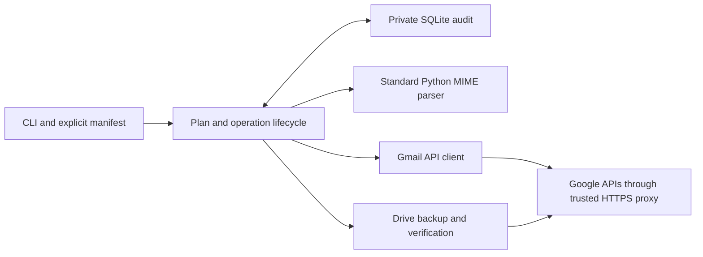

# Maintainer and operator handoff — read this first

This is a small synchronous Python CLI for removing **explicitly selected Gmail
attachments after retaining and verifying their exact bytes on Drive**. Gmail
cannot edit attachments in place: we reconstruct and insert a replacement with a
new Gmail ID, verify it, then separately approve moving the original to Trash.
The correspondence, labels, dates and thread must survive the planned transformation.
Nothing is sent. No search result becomes an automatic cleanup allowlist.

Five dummy messages completed this flow in a disposable account; API checks passed
and the user confirmed correct Gmail UI rendering. That evidence is limited to the
tested cases. **Credentials and an earlier test are not authorization to access or
change a real mailbox.** Default to offline work until the current task authorizes
specific live access. The completed disposable test must not be restarted as a new
operation. Read [REPORT.md](REPORT.md) for evidence and remaining limitations.

## Runtime architecture and repository map

Python 3.11+, one local process, standard-library MIME parsing and private SQLite
state. No server, database service, worker, scheduler, GUI or connector is involved.
`gmail-cleanup` enters `cli.main`; `gmail-cleanup-synthetic` enters `synthetic.main`.
Core/offline code uses the standard library. Optional `.[gmail]` dependencies provide
Google's API client, OAuth desktop consent and proxy transport support.



| File | What to inspect there |
| --- | --- |
| [README.md](README.md) | Detailed operator commands, note format, supported MIME and retention. |
| [docs/GOOGLE_SETUP.md](docs/GOOGLE_SETUP.md) | User-owned project, Desktop OAuth, secure bindings, hosts and publication. |
| [REPORT.md](REPORT.md) | Verified live/offline behavior versus untested cases. |
| [pyproject.toml](pyproject.toml) | Python/dependency requirements and CLI entry points. |
| [gmail_cleanup/cli.py](gmail_cleanup/cli.py) | Commands, dry-run defaults, authentication choice and approval flags. |
| [gmail_cleanup/manifest.py](gmail_cleanup/manifest.py) | Exact ID allowlists and original MIME-part/hash selections. |
| [gmail_cleanup/api.py](gmail_cleanup/api.py) | OAuth refresh, raw Gmail fetch, insert, thread read, exact-message Trash; no automatic write retries. |
| [gmail_cleanup/mime.py](gmail_cleanup/mime.py) | MIME validation/transformation, hashes, notes, transport allowlists and header auditing. |
| [gmail_cleanup/drive.py](gmail_cleanup/drive.py) | Backup lookup/deduplication, persisted upload IDs, metadata and downloaded-byte verification. |
| [tests/test_drive_links.py](tests/test_drive_links.py) | Canonical webViewLink propagation, exact HTML href/escaping and immutable legacy-link recovery. |
| [gmail_cleanup/preflight.py](gmail_cleanup/preflight.py) | Validate source, retain attachments, reconstruct locally, emit resolved selections/plans; no Gmail writes. |
| [gmail_cleanup/engine.py](gmail_cleanup/engine.py) | Immutable plan checks, create/verify/reconcile/Trash lifecycle and post-Trash recovery. |
| [gmail_cleanup/storage.py](gmail_cleanup/storage.py) | Private file writes, SQLite operations/backups and durable event history. |
| [gmail_cleanup/workflow.py](gmail_cleanup/workflow.py) | Sequential full-flow runner reserved for disposable accounts; stop at first failure. |
| [gmail_cleanup/fixtures.py](gmail_cleanup/fixtures.py), [synthetic.py](gmail_cleanup/synthetic.py) | Eleven offline fixtures and a registered synthetic live harness that creates replacements only. |
| [tests/helpers.py](tests/helpers.py) | In-memory Gmail/Drive fakes, including interrupted writes and corrupt responses. |
| [examples/](examples/) | Fictional version-1/version-2 selection examples; replace placeholders after inspection. |
| [.github/workflows/offline.yml](.github/workflows/offline.yml) | Credential-free CI tests. |

The engine is the safety boundary. Do not add a direct Gmail write to a script that
bypasses its checks/state transitions. API services use static SDK discovery rather
than fetching discovery documents at runtime. Environment OAuth is refreshed in
memory; clients use the inherited HTTPS proxy and CA trust. Raw messages/payloads
are held in memory, not logged. `--offline-sources` uses a read-only local mailbox
adapter, not a write simulation. Full write simulation uses the in-memory test fakes.

## Credentials and exact runtime requirements

Enable Gmail API and Drive API in a user-owned Google Cloud project. Desktop OAuth
consent occurs on the user's computer. Production needs exactly:

```text
https://www.googleapis.com/auth/gmail.modify
https://www.googleapis.com/auth/drive.file
```

`gmail.modify` covers read/insert/verify/Trash. `drive.file` covers app-created or
explicitly app-authorized files; it does not expose the whole Drive archive. Never
extract connector credentials or broaden scopes to bypass a failed check.

| Environment binding | Role |
| --- | --- |
| `GMAIL_CLIENT_ID` | Public Desktop OAuth client identifier; must match the client issuing the token. |
| `GMAIL_CLIENT_SECRET` | Secure Desktop client secret; routed only to the OAuth token host. |
| `GMAIL_REFRESH_TOKEN` | Secure refresh grant for the deliberately selected account; routed only to the token host. |
| `GMAIL_OAUTH_SCOPE` | Space-separated exact two scope URLs above; metadata does not extend Google's grant. |

`--env-auth` uses these bindings; `--token PATH` alternatively reads an explicitly
supplied private user-owned OAuth token file. Never print secrets, dump environment
values, log HTTP bodies, enable shell tracing or write proxy placeholders into a
token file. The environment currently configured by an operator must be checked,
not assumed to identify the desired mailbox.

| Required cloud API host | Calls |
| --- | --- |
| `oauth2.googleapis.com` | Refresh exchange; sole secret-injection destination. |
| `gmail.googleapis.com` | Raw message/thread reads, insert and Trash. |
| `www.googleapis.com` | Drive metadata, ID generation, upload and binary download. |

Local browser consent additionally uses `accounts.google.com`; dependency installs
use `pypi.org`/`files.pythonhosted.org` and existing development presets. Those are
separate from runtime API requirements. Preserve proxy routing and TLS verification.
Draft saving and publication differ: use the environment UI's Publish action after
settings changes. Runtime clients/connections must be initialized in each new task.

## End-to-end sequence and data contracts

1. **Gmail inspection:** fetch an explicitly allowlisted original's raw MIME and
   ID/thread/labels/internalDate. Inspect its original MIME paths and decoded hashes.
2. **Drive retention:** locate an intended app-accessible counterpart or upload one
   only when enabled. Validate MIME/source selection before uploading.
3. **Drive verification:** hash the complete downloaded bytes and check intended
   file ID, pinned name/parent destination, expected size and binary/non-trashed state.
4. **Reconstruction and plan:** remove only selected attachment leaves; preserve
   unselected resources and original decoded correspondence; append a readable note
   with filename, Drive's verified canonical `webViewLink` and matching SHA-256. Persist exact expected
   inventories, headers, hashes, metadata and plan digest.
5. **Insertion:** recheck source and Drive, regenerate approved bytes and persist
   `insert_pending` before `users.messages.insert`, using the original thread/labels
   and `internalDateSource=dateHeader`. Record the new replacement ID.
6. **Gmail verification:** fetch the actual replacement, compare semantic MIME,
   headers, labels, dates and thread membership, and freshly verify source/Drive.
7. **Trash:** after separate exact approval and another fresh verification, persist
   `trash_pending` then call `users.messages.trash` on the original only. Reverify
   original-in-Trash, replacement, thread and retained Drive files afterward.

A version-2 backup manifest contains exactly its explicit ID allowlist and selected
`part`/`decoded_sha256` values, optionally `drive_file_id`. A successful preflight
resolves it to version 1, adding `retained_sha256` and `drive_url`. MIME paths address
the **original raw tree**, not filenames, Gmail attachment IDs or replacement paths.
All attachment hashes must agree. Read-only inspection accepts empty version-1
selection lists. See [manifest.py](gmail_cleanup/manifest.py) and [examples](examples/).

Keep one private database per mailbox and one operator at a time. Do not combine
real-mailbox state with disposable fixtures. SQLite records original/replacement
IDs, operation marker, immutable plan, verification results, upload IDs and state,
plus append-only event history. Audit subjects, IDs, filenames, links, Date/reply
headers and hashes are sensitive even without bodies/tokens. Store all manifests,
raw fixtures, tokens and audits in ignored `.private/` or outside the repository.
Back up the database securely; losing it loses the recovery record.

## Safety gates: what must remain exact

Before the first Trash request, all of these must hold:

- The manifest explicitly selects this original ID/part/hash; the saved plan digest
  and regenerated approved bytes match. Signed/encrypted, attached-email and
  ambiguous MIME are rejected rather than guessed at.
- The original's exact raw hash, ID, thread, labels and internalDate still match its
  planning snapshot. Draft, Spam, Trash and unsupported classification state are
  excluded from new plans. Concurrent user edits stop the operation.
- Retained Drive identity, pinned filename/destination, size, binary/non-trashed
  state and complete downloaded SHA-256 pass fresh verification against source.
- The replacement has a distinct recorded Gmail ID and exact operation marker.
  From/To/Cc/Subject, Message-ID/In-Reply-To/References where present, and every other
  non-transport root header match the approved reconstruction.
- Original decoded text/HTML plus the approved note, MIME structure, every nested
  MIME header and every unselected/inline resource hash remain exact; selected
  attachments are absent. UTF-8/base64 body normalization is intentional and planned.
- Replacement labels (including read/unread, starred and sent state), Date and
  internalDate match expectations and original ordering. Its thread ID is the
  original's and the fetched thread contains both original and replacement.
- Verification state is `verified`; execution uses modify-capable authentication,
  `--execute --enable-trash`, the exact approved plan SHA-256 and replacement ID.

A verification failure leaves the pre-Trash original untouched and reports any
created replacement. Never rewrite semantic headers, override failed gates, or
claim a missing original proves success. Post-Trash verification checks the original
still exists with intact bytes/thread/internalDate and a TRASH label; original label
changes caused by Trash are audited separately from unchanged replacement labels.

### Drive deduplication and metadata settling

Default retention uses an app-created **Gmail attachment backups** folder. An
explicit accessible folder can be passed with `--drive-folder-id`. Lookup uses the
purpose tag `gmail-cleanup-backups-v1`, folder and source decoded SHA-256. Equal-byte
attachments can share a retained file even if filenames differ; the selected
counterpart's own name/destination is pinned. Multiple matching files/folders are
ambiguous and need explicit IDs. A corrupt tagged copy blocks the operation instead
of silently creating another backup. An explicit `drive_file_id` selects an intended
binary counterpart; its accessible metadata and actual bytes still must verify.

Version counters, timestamps, asynchronously populated checksums and detected
binary MIME types may settle after upload. These changes are audited, not required
to remain immutable. If metadata changes during a valid download, a bounded fresh
complete download/hash check guards against a same-size byte change. Renames,
destination/identity/size mismatches, missing/trashed/native files and wrong hashes
block. Drive-provided checksums and app tags never replace independent content
hashing. The tool never changes existing Drive file content, location or sharing.

New automatic selections copy `files.webViewLink` verbatim from the latest verified
Drive metadata, including query/resource-key parameters. Missing, unsafe or
wrong-file viewer URLs block resolution rather than causing a guessed URL fallback.
Supported HTTPS Drive viewer forms include `/file/d/ID/view` and `/open?id=ID`.
The exact URL is persisted in backup proof, manifest and note. HTML escapes query
ampersands once; parsed `href` must equal the canonical URL and end before the
semicolon preceding `SHA-256`. Existing approved/manual URLs are not silently
rewritten during recovery; current canonical links are separately audited.
Browser access needs the owning/authorized Google account. Never make the file
public to fix a wrong-session or sign-in problem. See [link regressions](tests/test_drive_links.py).

### Intentional header differences

Changing MIME/body bytes invalidates delivery signatures. Reconstruction removes
root DKIM-Signature, DomainKey-Signature, X-Google-DKIM-Signature, ARC-Seal,
ARC-Message-Signature, ARC-Authentication-Results, Authentication-Results,
Received-SPF and X-Google-Original-Authentication-Results. Original Received trace
remains in reconstructed bytes. Post-insert verification tolerates differences in
only that root transport/authentication allowlist plus Received, because Gmail may
add delivery metadata during insert. The exact approved raw hash/inventory/header
fingerprints are validated before applying this exception. It does not apply to
nested MIME headers, correspondence/threading headers, body bytes or attachments.

All source-to-replacement and expected-to-observed header differences are audited
by MIME path/name/value hashes, including header order/casing. Root marker and
planned body charset/encoding edits are intentional; unexpected semantic edits
remain fatal. Inspect [mime.py](gmail_cleanup/mime.py), [engine.py](gmail_cleanup/engine.py)
and [test_server_headers.py](tests/test_server_headers.py) before changing policy.

## Offline checks, demonstration and live pilot

From the checkout, install/test as described in [README](README.md#install-credentials-and-network).
The full offline suite needs no OAuth/network access:

```sh
.venv/bin/python -m unittest discover -v
```

The latest full result is 177 passing tests. To simulate the entire five-message
backup → insert → verify → Trash flow using in-memory fake services only:

```sh
.venv/bin/python -m unittest \
  tests.test_trash_workflow.SequentialWorkflowTests.test_five_messages_complete_in_order_with_hash_and_metadata_audit
```

For a CLI walkthrough without credentials or mailbox access, use a **new** directory
(generation refuses an existing directory):

```sh
.venv/bin/gmail-cleanup-synthetic generate --directory .private/handoff-demo
.venv/bin/gmail-cleanup plan \
  --manifest .private/handoff-demo/offline-selections.json --message-id offlineplain \
  --offline-sources .private/handoff-demo/offline-sources.json \
  --state .private/handoff-demo/audit.sqlite --output .private/handoff-demo/plan.json
.venv/bin/gmail-cleanup create \
  --manifest .private/handoff-demo/offline-selections.json --message-id offlineplain \
  --state .private/handoff-demo/audit.sqlite
```

The last command is a dry-run, not simulated insertion. Fixture links cannot satisfy
live Drive gates. Do not add execution/auth flags to turn this walkthrough into a
live experiment. Use the fake-service test above for full lifecycle simulation.

For an authorized **read-only live preview**, prepare a version-2 manifest from
inspected original part paths/hashes, then run:

```sh
.venv/bin/gmail-cleanup preflight --env-auth \
  --manifest .private/pilot/selections.json --state .private/pilot/audit.sqlite \
  --output .private/pilot/preview.json --resolved-manifest .private/pilot/resolved.json
```

This reads Gmail/Drive but uploads nothing and changes no email. It can exit 2 if no
accessible verified counterpart exists. `--upload-backups` separately permits Drive
creation; it still performs no Gmail writes. Dry-run does not mean no network reads
or local state writes. `create` without execution does not authenticate or read Gmail.

For a small live pilot, follow these steps in order:

1. Obtain authorization for the intended account/messages. Set up the exact scopes
   and hosts using [GOOGLE_SETUP](docs/GOOGLE_SETUP.md); check effective grants and
   account identity through read-only Gmail `users.getProfile` and Drive `about.get`.
   `auth-check --env-auth` alone proves refresh/client initialization, not API access
   or account identity. Do not automatically use a currently configured account.
2. Use a separate `.private/pilot/` manifest/database. Inspect one supported message,
   select exact original attachment parts/hashes and choose a zero predicted
   Date/internalDate ordering delta. Enable any necessary backup upload explicitly.
3. Review preview and exact persisted plan. After authorizing replacement creation,
   use `create --execute --env-auth` with that resolved manifest/ID/database.
4. Run `verify` on its known replacement and inspect Gmail UI, note/link/hash and
   retained-file access. Leave the original intact if any check fails.
5. Separately approve `trash --execute --enable-trash` with the saved exact plan
   hash and replacement ID. Read post-Trash results before selecting another message.

The complete commands are in [README's production operations](README.md#create-verify-then-separately-approve-trash).
`workflow --execute` requires `--disposable-test-account` and is reserved for
disposable accounts; do not misrepresent a production account to use that shortcut.
The eleven-fixture `synthetic` harness verifies registration markers/raw hashes and
creates replacement copies only; it never seeds, sends or trashes originals.

## Recovery and troubleshooting

First read `status` and the private audit, identify the saved original/replacement
IDs/state, and stop unrelated processing. Keep the same database/manifest and
operation marker. No blind API write retries, new databases to bypass uncertainty,
or manual verification-state edits are acceptable.

| State or failure | Action and code/tests to inspect |
| --- | --- |
| Drive `upload_pending` / lost upload response | Recheck the saved pre-generated file ID; resume that ID's creation only when missing and upload enabled. Do not allocate another ID. `drive.Backups`; [test_drive_preflight.py](tests/test_drive_preflight.py). |
| `planned` | Check exact source/selection/Drive expectations, then create from the same plan. `engine.create`. |
| `insert_pending`, no known replacement | Outcome is uncertain. Inspect Gmail read-only for the operation marker from the saved plan, identify the actual candidate, then reconcile. Do not insert again just because the response was lost. [test_engine.py](tests/test_engine.py). |
| `inserted` / `verified` | Reverify the recorded replacement. Creation retries reuse its ID. |
| `verify_failed` | Inspect `verification.checks` and `differences`, including header audit, timestamps, labels and Drive proofs. Fix the cause, then explicitly `verify` the known copy. Sequential runner deliberately stops on this state until resolved. |
| `trash_pending` / `trashed` / `trashed_verify_failed` | Reinvoke approval-gated `trash` for read-only recovery: inspect exact original TRASH label/bytes/thread/date, replacement and Drive. Never issue a second blind mutation. A confirmed post-Trash failure cannot undo the prior write; stop and report it. [test_trash_workflow.py](tests/test_trash_workflow.py). |
| Wrong hash/name/parent/size or missing/native Drive file | Do not insert/Trash. Inspect pinned counterpart and complete downloaded-byte proof. Metadata version changes alone are benign. [test_drive_integrity.py](tests/test_drive_integrity.py). |
| Multiple matching backups/folders | Provide intended `drive_file_id`/`--drive-folder-id`; do not arbitrarily choose or create duplicates. |
| Note link does not open | Compare the actual HTML href with `files.webViewLink`, including query parameters. Check account/session access; SHA punctuation belongs outside the anchor. An API download does not establish browser session identity. Inspect `test_drive_links.py`; do not make backups public or regenerate messages blindly. |
| Unsupported MIME or nonzero ordering delta | Skip this message and explain why; do not force success by editing headers or weakening gates. [test_mime.py](tests/test_mime.py). |
| OAuth/403/network/TLS failure | Check effective grants, Desktop client/token pairing, API enablement, intended account, exact active hosts and trusted CA/proxy. Renew consent when needed. Never expose request bodies or secrets. [GOOGLE_SETUP troubleshooting](docs/GOOGLE_SETUP.md#read-only-readiness-checks-before-a-pilot), [test_api_cli.py](tests/test_api_cli.py). |
| SQLite state conflict/private-file error | Stop concurrent operators; inspect permissions and saved state. Do not delete/reset the audit or force-follow a symlink. `storage.py`. |

Candidate reconciliation with the original ID, saved manifest and same database:

```sh
.venv/bin/gmail-cleanup reconcile --env-auth --manifest .private/pilot/resolved.json \
  --message-id GMAILID --replacement-id CANDIDATEID --state .private/pilot/audit.sqlite
```

The default is inspection. Adding `--execute` persists local reconciliation and
verifies the candidate; it does not insert a message. After fixing a known failed
copy, use `verify` rather than recreating it. Treat nonzero command exits as failures:
the CLI reports saved state/known replacement where available. Preserve audits even
if an operator later resolves a failure manually in Gmail.

## Limits, retention and maintenance priorities

- Five received-style live messages shared one thread; other thread layouts,
  sent-mail labels, custom label combinations and large live messages remain untested.
  Offline received/sent/thread fixtures do not establish Gmail server behavior.
- Signed/encrypted MIME, nested attached messages and ambiguous structures are
  unsupported. Body normalization/notes and transport-signature removal intentionally
  change raw bytes; original DKIM/ARC authenticity is not preserved.
- `internalDateSource=dateHeader` cannot guarantee original ordering when Date and
  internalDate differ. Any discrepancy remains a blocker, not an override opportunity.
- Cross-service operations are not atomic. External changes between verification
  and mutation remain a risk. One operator per mailbox/database is an operating
  requirement, not a global distributed lock implemented by the tool.
- Gmail normally removes originals from Trash after 30 days. Keep retained Drive
  copies accessible and unchanged. Long-term retention checks and reversal automation
  are not implemented; note links do not grant recipients Drive permissions.
- Existing archived Drive files may be outside app access; native documents are not
  exact binary counterparts. Complete raw MIME is held in memory, so offline 4 MiB
  coverage does not establish every Gmail/Drive size limit.
- External/Testing refresh tokens normally expire after seven days. Google OAuth
  app verification/distribution requirements differ from environment publication.
- Ignored local audits/credentials can be included in an environment snapshot; do
  not distribute snapshots as sanitized source. Review staged paths/content before
  committing, and never force-add private evidence.

When changing behavior, begin with its code owner and regression test above, preserve
existing approved-plan compatibility, and rerun the full offline suite. Any new live
behavior should first use explicitly authorized disposable fixtures. Keep this
document, [README](README.md), [setup guide](docs/GOOGLE_SETUP.md) and [REPORT](REPORT.md)
consistent; report measured API/UI outcomes separately from assumptions.
